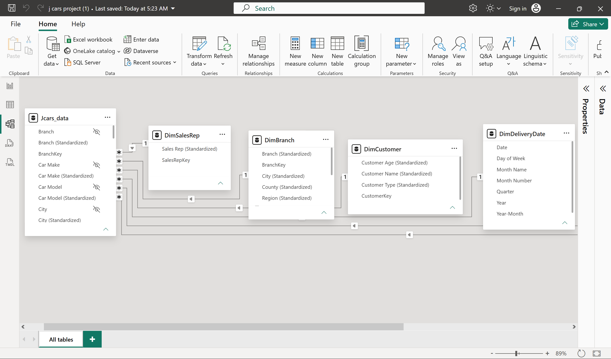
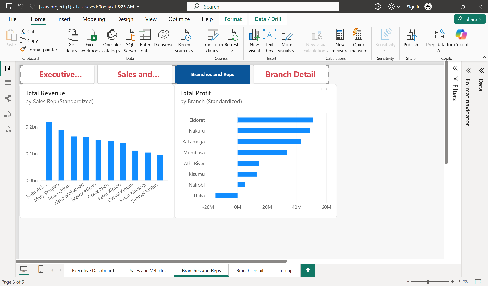

# JCars Logistics: Power BI Sales Analysis

A Power BI solution built from a messy raw CSV of vehicle sales for a Kenyan car dealership. This is the assessment project for LuxDev Cohort 9 (Data Engineering).

**Author:** Kenneth Kiprotich
**Tools:** Power BI Desktop, Power Query (M), DAX

---

## 1. Dataset and grain

- **Source file:** `Jcars_data.csv`, 276 rows and 32 raw columns.
- **Grain:** one row per sale line. `Order ID` is not unique, so a surrogate key `SalesKey` (an index) was added.
- **Content:** order and delivery dates, customer, branch and location, sales rep, vehicle attributes, price, cost, discount, delivery and logistics cost, payment and delivery status, rating, return flag and recorded revenue.

## 2. Data model



Star schema with `Jcars_data` as the fact table and six dimensions. All six relationships are Many-to-One, active, single direction.

| Table | Rows | Key |
|---|---|---|
| DimVehicle | 271 | VehicleKey |
| DimCustomer | 276 | CustomerKey |
| DimBranch | 8 | BranchKey |
| DimSalesRep | 10 | SalesRepKey |
| DimOrderDate | calendar 2015-2026 | Date |
| DimDeliveryDate | calendar 2015-2026 | Date |

`DimCustomer` stays at 276 rows because there is no reliable key to de-duplicate customers. This is a known limitation.

## 3. Data quality issues and how they were handled

26 standardized columns were built in Power Query. The raw columns are kept and hidden from the report view.

| Issue | Handling |
|---|---|
| Money columns in mixed formats (KES, KSh, USD, EUR, GBP shown as `?`, ZAR as `R ` or `ZAR`, "0.02M", commas, text such as "missing", "TBD", "#VALUE!") | Parsed to numbers, converted to KES, text placeholders set to null |
| Negative values in money columns | Sign corrected with an absolute value (see assumptions for revenue) |
| Misspelled makes and models ("totoya", "mitshubishi", "corrola") | Lookup lists that map every raw value to one clean name |
| Inconsistent categories (vehicle type, fuel, transmission, colour, customer type, region, county, city, branch) | Mapping tables per column, unmatched values set to "Unknown" |
| Sales rep names with the digit "1" in place of "i" | Replaced systematically, giving 10 real reps |
| Dates as Excel serial numbers, DD/MM/YYYY, named months, dd-Mon-yy | Parsed in one custom step, impossible dates set to null |
| Units sold, discount and ratings as words or text ("two", "10 percent", "4.5 out of 5") | Converted to numbers, impossible values (for example a rating above 5) set to null |
| Payment status with 32 spellings, delivery status with about 35 | Collapsed to 7 payment and 6 delivery statuses, blanks left as null |

### Currency conversion

| Currency | Rate to KES |
|---|---|
| USD | 129.68319103 |
| EUR | 147.47571894 |
| GBP | 171.88471337 |
| ZAR | 7.92526070 |

*Source and date of the rates: XE.com, 29 September 2026.*

## 4. Assumptions

1. **Negative revenue on paid or completed orders** is a sign error, so it was flipped to positive. The magnitude matched units times price.
2. **Negative revenue on cancelled orders is set to 0.** No sale means no revenue. Zero revenue on cancelled or refunded orders is valid and kept.
3. **Delivery fee is paid by the customer**, so it is not a cost and is excluded from profit.
4. **Sales with blank revenue are excluded from cost and profit**, because their earnings are unknown. Including their cost would show a false loss.
5. **Cancelled orders are excluded from cost and logistics cost.**
6. **Branch is matched on City only.** There is one branch per city, and matching on all four location fields left about 2% of sales without a branch. Four Nairobi sales with the raw branch "main yard" are assigned to Nairobi for this reason.
7. **"complete" and "completed" payment statuses are treated as Paid.**
8. **"held" delivery status is treated as Delayed.**

## 5. DAX measures

```
Total Revenue = SUM(Jcars_data[Revenue Clean(KES)])
Total Units = SUM(Jcars_data[Units Sold (Standardized)])
Total Sales = COUNTROWS(Jcars_data)

Total Cost =
SUMX(
    FILTER(Jcars_data,
        Jcars_data[Payment Status (Standardized)] <> "Cancelled"
        && NOT ISBLANK(Jcars_data[Revenue Clean(KES)])),
    Jcars_data[Unit Cost(KES)] * Jcars_data[Units Sold (Standardized)]
)

Total Logistics Cost =
SUMX(
    FILTER(Jcars_data,
        Jcars_data[Payment Status (Standardized)] <> "Cancelled"
        && NOT ISBLANK(Jcars_data[Revenue Clean(KES)])),
    Jcars_data[Logistics Cost(KES)]
)

Total Profit = [Total Revenue] - [Total Cost] - [Total Logistics Cost]
Profit Margin % = DIVIDE([Total Profit], [Total Revenue])
Avg Revenue per Sale = DIVIDE([Total Revenue], [Total Sales])

Blank Revenue Sales =
COUNTROWS(FILTER(Jcars_data,
    ISBLANK(Jcars_data[Revenue Clean(KES)])
    && Jcars_data[Payment Status (Standardized)] <> "Cancelled"))
```

`Cost of Blank Revenue Sales` is a diagnostic measure used to investigate branch losses.

## 6. Report design

| Page | Content |
|---|---|
| Executive Dashboard | Revenue, profit, margin and sales cards, monthly revenue trend, revenue by branch, year slicer |
| Sales and Vehicles | Revenue by car make, revenue by vehicle type, year slicer |
| Branches and Reps | Revenue by sales rep, profit by branch, branch breakdown table |
| Branch Detail | Drill-through page: reps, revenue, profit and sales for the selected branch |
| Tooltip | Hover page showing profit and margin for the branch under the mouse |




**Interactivity:** year button slicers, cross-filtering between visuals, one drill-through (branch to branch detail), one report-page tooltip, and a page navigator.

## 7. Analyst questions and insights

| Question | Finding |
|---|---|
| Which branch earns the most revenue and which the most profit? | Kakamega leads revenue, Eldoret leads profit |
| Which branch loses money? | Thika: -14.9m profit. Costs exceed revenue, and logistics (4.7m) is not the cause |
| Who is the top sales rep? | Faith Achieng, by revenue |
| Which make and vehicle type sell best? | Toyota and SUV, by revenue |
| What is the overall margin? | About 13.1% (194.3m profit on 1.48bn revenue, 276 sales) |

**Data caveat:** about 5% of revenue values are blank, so profit totals are slightly understated.

## 8. Recommendations

1. **Review Thika's pricing and discounting.** Its losses may be caused by deeper discounts or higher purchase costs. This was not tested.
2. **Compare Eldoret with Kakamega.** Eldoret earns more profit on less revenue, so its pricing and discount practice is worth studying.
3. **Keep Toyota SUV stock steady.** They lead sales.
4. **Fix data capture at the source.** Blank revenues and unreadable order dates should be recorded properly.

## 9. Challenges and lessons learned

- **Silent formula failure.** Looking up a record field with `Record.Field` failed silently for car make and model. Rebuilding it with `List.Select` over a list of pairs, then checking against every raw value, fixed it.
- **Merge fan-out.** Merging a dimension on only one key column multiplied the fact table from 276 to 61,544 rows. Every merge must use all matching columns, and the row count must be checked after each one.
- **Copy-paste slip.** Four money columns were all reading from `[Unit Selling Price]`, so cost, fees and revenue silently matched the price. Checking that the columns differed from each other caught it.
- **Wrong data type.** Custom columns had no number type, so Power BI treated them as text and could not sum them. The Σ icon in the Data pane shows whether a column is numeric.
- **Over-strict join.** Matching branch on four location fields left 2% of sales without a branch key, because one "Unknown" value broke the match.
- **Wrong chart type.** A 100% stacked column chart made every rep look equal. The model was fine, the chart type was not.

## 10. Limitations

- Customers are not de-duplicated (276 customer rows).
- Exchange rates are fixed, not rates on the order date.
- The report covers sales, vehicles, branches and reps. Customer, payment, logistics, returns and customer-experience pages are not built yet.
- **Date format gap.** The date rule reads every `xx/xx/yyyy` value as DD/MM. About 31 dates that are clearly MM/DD (for example `02/21/2025`) are therefore set to null. Another 93 slash dates are ambiguous, because both parts are 12 or below, and are read as DD/MM.
- **Columns not cleaned yet:** Payment Method, Lead Source and Review Count. Payment and delivery status are cleaned.

## 11. Detailed data issue log

What was found, then the decision. Counts come from profiling the raw file.

1. **Order ID:** 276 rows but 257 distinct IDs. Three IDs repeat, and each repeat is a different order. 19 rows hold `N/A`, `-` or blank, and formats are mixed (LC, LCL-, ORD, CAR, lowercase). *Decision:* kept every row and added `SalesKey` as the real key.
2. **Returned:** 19 spellings. Result: 88 Returned, 168 Not Returned, 20 Unknown (blank or `-`). *Decision:* Unknown kept separate so the return rate isn't understated.
3. **Currencies in 5 money columns:** KES, USD, EUR, GBP (the `£` sign was lost to ASCII encoding and became `?`), ZAR (`R ` and `ZAR`), `M` suffixes and error text. *Decision:* converted to KES at fixed XE rates dated 29 September 2026. Unmarked values were treated as KES, and error text became null.
4. **Negative values:** negative prices, costs, delivery fees and logistics costs were treated as sign errors and made positive. Negative revenue on paid or completed orders was made positive, and negative revenue on cancelled orders was set to 0.
5. **Discount:** `5%`, decimals, `ten percent`, `twenty%`, `5 percent`, `No Discount`, `Disc`. *Decision:* `No Discount` became 0, `Disc` and blanks became null. Four rows at 120% were set to null, because that would mean paying the customer.
6. **Units Sold:** `3 cars`, `two`, `one`, `-1`, `0` and blanks. *Decision:* words and text converted, impossible or missing values set to null.
7. **Customer Rating:** `out of 5`, `/5` and bare numbers. *Decision:* two values of 6 set to null.
8. **Dates:** serial numbers, DD/MM, named months, `dd-Mon-yy`, plus impossible dates such as `2026-13-04`, `April 31 2026` and `#DATE!`. *Decision:* impossible or unreadable dates set to null. See the date format gap in section 10.
9. **Vehicle Year:** `1899` (an Excel zero date), `2032`, `202A`, `Twenty Twenty`, blanks. *Decision:* `Twenty Twenty` became 2020, everything outside 2000-2026 became null.
10. **Vehicle attributes:** Make had 28 spellings and Model about 70. Fuel (`PMS`, `gasoline`), Transmission, Type (`saloon`) and Color (`Gre`, `Whi`) also varied. *Decision:* standardized. `lc200` was kept apart from `c200`, `Gre` became Unknown, and variants such as `Fit Hybrid` were folded into the base model.
11. **Customer Type:** 34 spellings reduced to 9 categories. NGO, Non Profit, Retail and County Government were kept separate.
12. **Customer Name and ID:** casing varied, and `N/A` and blanks were used as names. There is no Customer ID, so common names may be different people. *Decision:* names standardized, `DimCustomer` kept at 276 rows, limitation documented.
13. **Customer Age:** `0`, `-5`, `121`, `thirty` and blanks. *Decision:* impossible values set to null, `thirty` became 30.
14. **Location:** typos and abbreviations (`NBI`, `Nairobii`), Eldoret entered as a county, suburbs listed as cities. *Decision:* Eldoret became Uasin Gishu, Mt Kenya became Central, suburbs folded into their parent city, one branch per city, `Main Yard` became Unknown.
15. **Sales Rep:** 80 raw values for 10 people. `1` was used in place of `i`, some names had double spaces, and some were first-name-only. *Decision:* mapped to the 10 names.
